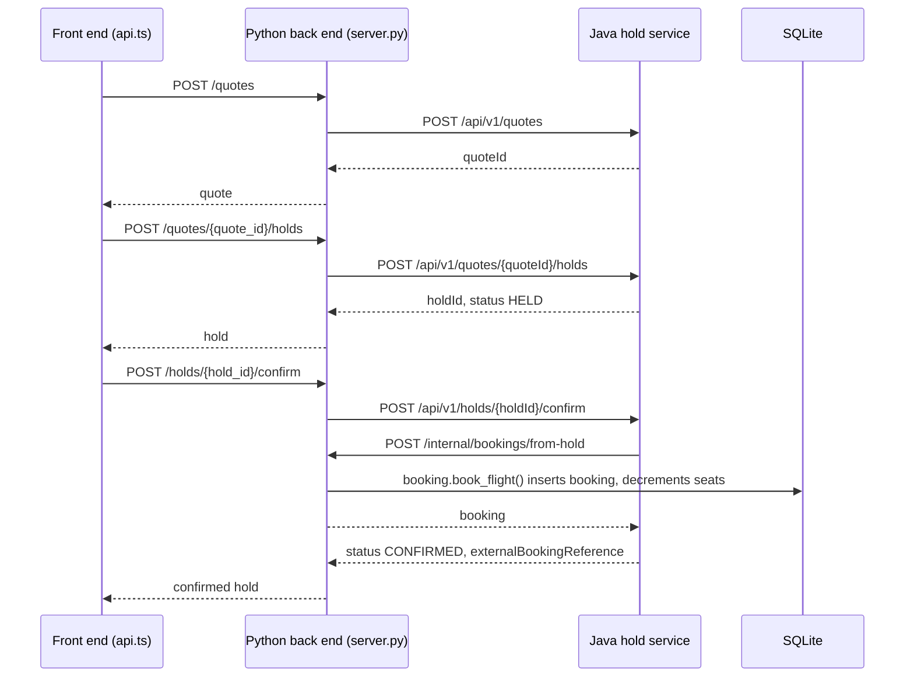

<!-- STAND-IN: replace with the diagram from the module 2 authoring run. -->
# Booking flow

## Booking through the hold service

This diagram shows how a traveler's seat goes from a quote to a hold to a confirmed booking across the front end, the Python back end, and the Java hold service.

