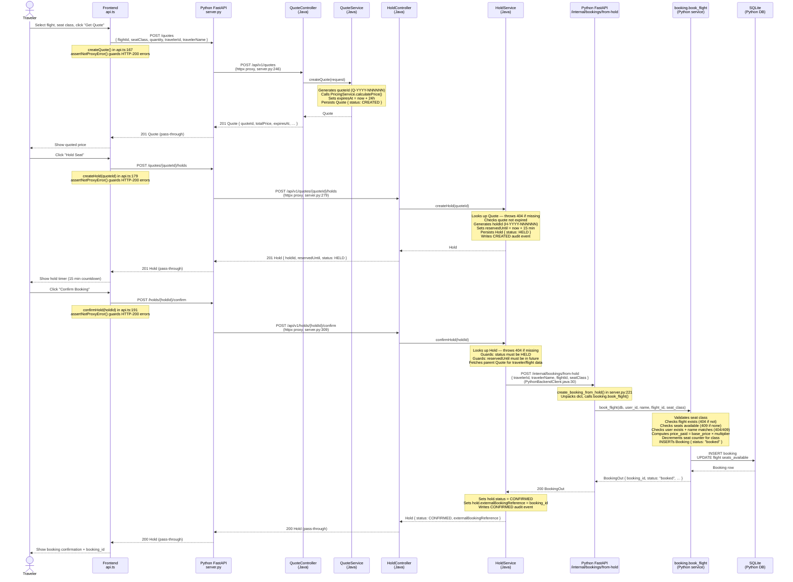

# Booking through the hold service

This diagram shows the full request path when a traveler quotes, holds, and confirms a seat — including the Java hold service's callback to `/internal/bookings/from-hold` that creates the final booking record in the Python database.

